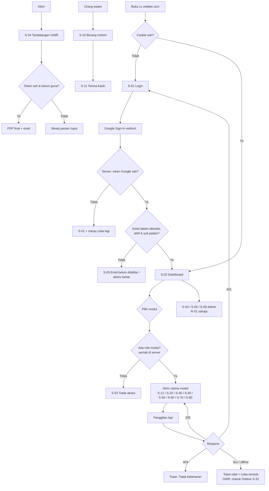

# AFD: Voltake Operations Portal
Tarikh: 19/11/2026 | Versi: 1.3 (draf, dikemas kini 19/11/2026) | Rujuk: 01-PRD, 02-TRD

## 1. Overview

Staf buka `cc.voltake.com` (atau ikon PWA). Kalau belum login, nampak skrin login dengan satu butang Google. Selepas login, nampak dashboard dengan kad modul yang dia dibenarkan sahaja, macam mockup "Welcome to Voltake Operations Portal". Tekan kad, modul dibuka dalam laluan sendiri (`/claimpro/`, `/gwr/`, ...) dengan header portal yang sama, jadi tak perlu login semula. Orang awam hanya sampai ke dua laluan public: borang mohon kerja dan pautan tandatangan GWR.

## 2. Senarai Skrin

Lajur "Data" merujuk tab dalam 05-BSD (format `Sheet.Tab`).

### 2.1 Portal teras

| ID | Skrin | Role | Feature | Tujuan | Data |
|----|-------|------|---------|--------|------|
| S-01 | Login | semua staf | F-01 | Butang "Log masuk dengan Google" | - |
| S-02 | Dashboard portal | R-01 hingga R-11 | F-02, F-09 | Banner selamat datang + grid kad modul | VP-Access.Modules, roles user |
| S-03 | Tiada akses / ralat | semua | F-02 | Papar bila buka modul tanpa role, atau sesi tamat | - |
| S-04 | Admin: Senarai staf (allowlist) | R-01, R-02 (status sahaja) | F-03, F-06 | Daftar emel staf baru, tukar department/status, reset ikatan akaun Google | VP-Access.Staff |
| S-05 | Admin: Akses staf | R-01 | F-03 | Matriks staf x modul: tanda modul dan pilih role untuk setiap staf, ikut designation yang dipapar di sebelah nama. Butang "Salin akses dari staf lain". Sebab wajib bila simpan | VP-Access.UserAccess, AccessChangeLog |
| S-06 | Admin: Audit log | R-01 | F-05 | Tapis log login & tindakan | VP-Access.LoginLog, `<modul>.AuditLog` |
| S-07 | Panduan install PWA | semua | F-04 | Langkah bergambar iOS, Android, desktop | - |
| S-08 | About / More Info | semua | F-09 | Info syarikat, versi, hubungi IT | VP-Access.Settings |
| S-09 | Dashboard KPI | R-01, R-11 | F-08 (Tambahan) | Angka ringkasan setiap modul | action `summary` setiap modul |

### 2.2 Draft Mohon Kerja

| ID | Skrin | Role | Feature | Tujuan | Data |
|----|-------|------|---------|--------|------|
| S-10 | Borang mohon kerja (public) `/public/mohon` | R-12 | F-10 | Isi permohonan, notis privasi, consent, Turnstile | VP-HR.Positions, Applicants |
| S-11 | Terima kasih (public) | R-12 | F-10 | Pengesahan + no. rujukan | Applicants.app_no |
| S-12 | HR: Senarai pemohon | R-02 | F-11 | Jadual, tapis jawatan/dept/status | Applicants (IC dimask) |
| S-13 | HR: Profil pemohon | R-02 | F-11, F-14 | Butiran penuh, resume, status, catatan, jadual interview | Applicants, Interviews |
| S-14 | HR: Setup jawatan | R-02 | F-13 | Buka/tutup jawatan | Positions |
| S-15 | Interviewer: Papan | R-09 | F-12 | Pemohon dept sendiri, beri markah & catatan | Applicants (medan terhad), Interviews |

### 2.3 Cost Calculator

| ID | Skrin | Role | Feature | Tujuan | Data |
|----|-------|------|---------|--------|------|
| S-20 | Kalkulator | R-03, R-04 | F-20 | 4 seksyen input + keputusan margin + jana gambar | Rates (baca), input user |
| S-21 | Senarai estimate | R-03, R-04 | F-21 | Cari, buka, duplicate | Estimates |
| S-22 | Admin kadar | costcalc `admin` | F-22 | Edit kadar kos | Rates |

### 2.4 GWR

| ID | Skrin | Role | Feature | Tujuan | Data |
|----|-------|------|---------|--------|------|
| S-30 | Borang GWR | R-05 | F-30, F-31 | Isi report, gambar, tandatangan staf, simpan draf/hantar | Reports, Settings |
| S-31 | Outbox offline | R-05 | F-31 | Senarai GWR menunggu dihantar | IndexedDB tempatan |
| S-32 | Dashboard GWR | R-05, R-01 | F-33 | Senarai ikut dept & tahap, carian PO, status | Reports |
| S-33 | Butiran GWR | R-05 | F-33, F-34 | Lihat PDF draf/final, hantar semula pautan klien | Reports |
| S-34 | Tandatangan klien (public) `/public/gwr-sign?t=` | R-13 | F-32 | Klien semak & sign | Reports (medan terhad) |

### 2.5 AMS

| ID | Skrin | Role | Feature | Tujuan | Data |
|----|-------|------|---------|--------|------|
| S-40 | Senarai aset | R-06 | F-40 | Jadual + carian + status | Assets |
| S-41 | Butiran / tambah aset | R-06 | F-40, F-41 | Borang aset, sejarah kalibrasi | Assets, CalibrationLog |
| S-42 | Audit aset | R-06 (`auditor`) | F-42 | Rekod audit dengan gambar | Audits |
| S-43 | Mobiliti | R-06, peminjam | F-43 | Pinjam, pulang, lulus pemulangan | Movements |

### 2.6 ClaimPro

| ID | Skrin | Role | Feature | Tujuan | Data |
|----|-------|------|---------|--------|------|
| S-50 | Tuntutan saya | R-07 | F-50 | Senarai tuntutan sendiri + status | Claims (sendiri) |
| S-51 | Borang tuntutan | R-07 | F-50 | Hantar/edit draf + muat naik resit | Claims, ClaimTypes |
| S-52 | Kelulusan | R-08 (claimpro `admin`) sahaja | F-51 | Senarai menunggu, lulus/tolak dengan sebab | Claims, Approvals |
| S-53 | Sahkan terima bayaran | R-07 (pemilik claim sahaja) | F-52 | Staf rekod tarikh, jumlah diterima dan bukti untuk claim sendiri yang Lulus | Claims (sendiri) |
| S-54 | Laporan | R-08 (claimpro `admin`) sahaja | F-53 | Tapis bulan/jenis, eksport | Claims |

### 2.7 Compliance Track

| ID | Skrin | Role | Feature | Tujuan | Data |
|----|-------|------|---------|--------|------|
| S-60 | Dashboard compliance | R-02, R-04 | F-60 hingga F-63 | Kiraan luput 30/60/90 hari | Vehicles, Chargeman, StaffCerts |
| S-61 | Kenderaan | R-02, R-04 | F-60 | CRUD kereta & motosikal | Vehicles |
| S-62 | Chargeman | R-02, R-04 | F-61 | CRUD kompetensi | Chargeman |
| S-63 | Sijil semua staf | R-02, R-04 | F-62 | Matriks sijil staf | StaffCerts |
| S-64 | Sijil saya | R-07 | F-62 | Staf kemas kini sijil sendiri | StaffCerts (sendiri) |
| S-65 | Job log | R-04 | F-64 | Log kerja PSS | JobLog |

### 2.8 ClaimReport

| ID | Skrin | Role | Feature | Tujuan | Data |
|----|-------|------|---------|--------|------|
| S-70 | Borang DO | R-10 (Strategic Planning) | F-70 | Isi DO, item, jana PDF + Excel | DeliveryOrders, Parties, Template |
| S-71 | Dashboard DO | R-10 | F-71, F-72 | Senarai, carian, edit/padam (admin) | DeliveryOrders |

### 2.9 Voltrack

| ID | Skrin | Role | Feature | Tujuan | Data |
|----|-------|------|---------|--------|------|
| S-80 | Senarai projek | semua role voltrack | F-80 hingga F-83 | Jadual projek + fasa semasa | Projects + 4 tab fasa |
| S-81 | Butiran projek | semua role voltrack | F-80 hingga F-83, F-85 | 4 tab fasa; hanya tab role sendiri boleh diedit | Commercial, Operation, Claim, LOD |
| S-82 | Dashboard eksekutif | R-03, R-11, voltrack `admin` | F-84 | Pipeline, invois tertunggak, kes LOD | semua tab |

## 3. Key User Journeys

### Journey: Login pertama dan install (R-07)
1. Staf terima pautan `cc.voltake.com` dalam WhatsApp/emel, buka di telefon.
2. S-01: tekan "Log masuk dengan Google", pilih akaun Google yang didaftar semasa onboard: akaun @voltake.com untuk pengurusan & engineer, Gmail peribadi untuk technician.
3. Server sahkan token dan semak allowlist. Jika emel tiada dalam VP-Access: S-03 "Emel ini belum didaftar. Hubungi Admin/HR" (paparkan emel yang dicuba supaya staf sedar kalau tersalah pilih akaun, dengan butang "Guna akaun lain"). Jika status tamat: S-03 "Akses anda telah ditamatkan". Jika `sub` tak padan: S-03 "Akaun tak sepadan, hubungi Admin".
4. Berjaya: S-02 dengan kad ikut role. Banner kecil "Install Voltake di telefon" dengan pautan ke S-07.
5. iOS: ikut S-07 (Share > Add to Home Screen), buka ikon, login sekali lagi (storan PWA iOS berasingan dari Safari).

### Journey: Hantar tuntutan (R-07)
1. S-02 > kad ClaimPro > S-50.
2. "Tuntutan baru" > S-51: pilih jenis, tarikh, amaun, keterangan, ambil gambar resit.
3. Simpan sebagai Draf atau Hantar. Server semak: amaun > 0, jenis sah, resit wajib jika `ClaimTypes.perlu_resit`.
4. Status jadi "Dihantar"; Admin ClaimPro dapat emel (dan push jika F-07). Staf (termasuk HR) tak nampak menu Kelulusan langsung.

### Journey: Lulus tuntutan (R-08 Admin ClaimPro: HR atau Head of Strategic Planner)
1. S-52: senarai semua tuntutan status "Dihantar".
2. Buka, lihat resit (melalui `getFile`), Lulus atau Tolak (sebab wajib bila tolak). Staf dapat emel.
3. Admin tak boleh lulus tuntutan sendiri (server tolak jika `staff_email` = admin). Claim staf HR hanya boleh diluluskan Head of Strategic Planner; claim Head of Strategic Planner diluluskan HR.
4. S-54: HR buka senarai "Lulus, belum dibayar" dan buat pindahan wang melalui bank (di luar sistem). Staf kemudian sahkan terima (journey di bawah). Claim staf HR diluluskan oleh Head of Strategic Planner.

### Journey: Sahkan terima bayaran (R-07 pemilik claim)
1. Staf terima wang dalam akaun bank.
2. S-50 > claim berstatus Lulus > "Saya dah terima bayaran" (S-53): isi tarikh terima, jumlah diterima, muat naik bukti (pilihan).
3. Status jadi "Dibayar". Jika jumlah ≠ amaun lulus, claim ditanda "Beza bayaran" dan Admin dapat emel.
4. Claim Lulus yang belum disahkan selepas 14 hari: staf dapat peringatan emel.

### Journey: Onboard staf baru (R-02 HR + R-01)
1. HR minta emel Google staf baru (Gmail peribadi atau akaun syarikat) dan pastikan 2-Step Verification hidup.
2. Admin di S-04: "Tambah staf", isi staff_id, nama, emel, department, designation.
3. Admin di S-05: tandakan modul dan role untuk staf tu ikut designation (atau "Salin akses" dari rakan sejawat, kemudian semak). Simpan dengan sebab. Tiada modul yang terbuka tanpa Admin tanda.
4. Staf login. Login pertama ikat `sub` Google ke rekod dia.

### Journey: GWR di site tanpa line (R-05)
1. Technician buka ikon PWA (app shell dari cache). S-30: isi borang, ambil gambar, sign.
2. Tekan Hantar. Tiada rangkaian: disimpan dalam S-31 Outbox dengan `client_req_id`.
3. Bila online dan app dibuka, outbox hantar automatik. Server tolak duplikat berdasarkan `client_req_id`.
4. Server jana PDF draf, cipta token klien, emel pautan S-34 kepada klien.
5. Klien buka S-34, semak, isi nama/jawatan, sign. Token mati. PDF final dijana dan dihantar ke staf & klien (F-34).

### Journey: Mohon kerja (R-12) dan saringan (R-02, R-09)
1. Pemohon buka `/public/mohon`. Pilih jawatan aktif, isi borang, baca notis privasi, tanda consent, Turnstile, Hantar.
2. Server sahkan Turnstile & rate limit, simpan dengan `consent_version`, resume ke folder Drive private. S-11 papar no. rujukan.
3. HR di S-12/S-13: saring, tukar status ke "Interview", tetapkan tarikh & interviewer dept.
4. Interviewer di S-15: nampak pemohon dept sendiri dengan IC dimask dan tanpa medan jenayah/KWSP; beri markah.
5. HR putuskan. Pemohon "Ditolak" masuk kiraan retention (F-14).

### Journey: Staf berhenti (R-02 / R-01)
1. S-04: cari staf, tukar status ke "tamat", isi tarikh tamat.
2. Dalam ≤ 10 minit semua panggilan API staf tu dapat 401; PWA papar S-01.

### Journey: Urus kadar kos (costcalc `admin`)
1. S-22: edit kadar, simpan. Nilai lama direkod dalam AuditLog. Estimate lama kekal dengan `rates_snapshot` asal.

## 4. App Flow Diagram

## 5. Navigasi

- **Header tetap** (semua skrin staf): logo Voltake (ke S-02), nama modul semasa, ikon notifikasi (F-07, bila ada), menu profil (nama, department, "Install app" ke S-07, "Log keluar").
- **Dashboard S-02**: kad modul ikut role, susunan ikut `VP-Access.Modules.susunan`. Kad "More Info" sentiasa ada. Kad "Admin" hanya untuk R-01.
- **Dalam modul**: tab bar atas (desktop) / bottom nav (mobile) dengan skrin modul yang role tu boleh buka sahaja.

| Modul | Menu dalam modul ikut role modul |
|---|---|
| hr | `hr_admin`: Pemohon, Jawatan · `interviewer`: Papan interview |
| costcalc | `user`: Kalkulator, Simpanan · `admin`: + Kadar |
| gwr | semua: Borang, Outbox, Dashboard (skop ikut tahap) |
| ams | `admin`: Aset, Kalibrasi, Mobiliti · `auditor`: + Audit · `staff`: Mobiliti (pinjaman sendiri) |
| claimpro | `staff`: Tuntutan saya, Sahkan terima bayaran · `admin` (HR, Head of Strategic Planner): + Kelulusan, Laporan, senarai untuk bayaran |
| compliance | `hr_admin`, `pss`: Dashboard, Kenderaan, Chargeman, Sijil, Job log (pss) · `staff_self`: Sijil saya |
| claimreport | `user`: Borang, Dashboard · `admin`: + edit/padam |
| voltrack | semua role: Projek, Dashboard; edit ikut fasa |

## 6. Keadaan Khas

| Keadaan | Paparan |
|---|---|
| Empty state | Ikon + ayat ringkas + butang tindakan utama (contoh "Belum ada tuntutan. Buat tuntutan pertama") |
| Loading | Skeleton baris jadual; butang hantar jadi disabled + spinner (elak hantar dua kali) |
| Ralat rangkaian | Toast merah "Tiada sambungan. Cuba lagi." + butang cuba semula. GWR: simpan ke Outbox |
| Ralat validasi | Mesej di bawah medan (dari server juga), fokus ke medan pertama yang salah |
| 401 sesi tamat | Simpan draf borang dalam `sessionStorage`, redirect ke S-01, pulihkan draf selepas login |
| 403 | Toast "Anda tiada kebenaran untuk tindakan ini" + tulis ke audit di server |
| Apps Script lambat (> 5 s) | Teks "Masih memproses..." selepas 3 saat |
| Mobile vs desktop | Jadual jadi senarai kad di < 640px; borang satu lajur; bottom nav di mobile |
| iOS PWA | Tiada butang install automatik, jadi banner pautan ke S-07 |

## 7. Notifikasi & Automasi

| Bila | Kepada | Saluran | Feature |
|---|---|---|---|
| Tuntutan dihantar | Admin ClaimPro | Emel (+ push F-07) | F-51 |
| Tuntutan lulus/ditolak | Staf pemohon | Emel | F-51 |
| Staf sahkan bayaran dengan jumlah berbeza | Admin ClaimPro | Emel | F-52 |
| Claim Lulus belum disahkan dibayar selepas 14 hari | Staf pemohon | Emel | F-52 |
| GWR dihantar | Klien (pautan sign) | Emel | F-32 |
| GWR disahkan klien | Staf + klien (PDF final) | Emel | F-34 |
| Setiap Isnin 8:00 pagi | HR, PSS | Emel ringkasan luput 30/60/90 hari | F-63 |
| Kalibrasi luput dalam 30 hari | AMS admin | Emel mingguan | F-41 |
| Permohonan kerja baru | HR | Emel harian 9:00 pagi (digest, bukan setiap permohonan) | F-11 |
| Setiap hari 2:00 pagi | sistem | Retention: anonimkan pemohon lepas tempoh, arkib tuntutan lama | F-14, F-53 |
| Setiap Ahad 2:00 pagi | sistem | Backup semua Sheet | TRD 6 |
