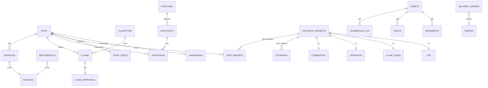

# BSD: Voltake Operations Portal
Tarikh: 19/11/2026 | Versi: 1.3 (draf, dikemas kini 19/11/2026) | Rujuk: 01-PRD, 02-TRD, 03-AFD

## 1. Overview

Database: **Google Sheets**, satu spreadsheet baharu per modul + satu spreadsheet akses pusat. Semua dimiliki `systems@voltake.com`, tidak dikongsi kepada sesiapa selain admin IT, dan **tidak pernah** "Publish to Web". Hanya Apps Script modul masing-masing baca/tulis Sheet modul itu. Sebab pilih Sheets: zero-cost, data kekal berasingan per modul (permintaan pemilik), dan saiz data sekarang kecil. Kriteria pindah ke Supabase ada dalam TRD seksyen 7.

| Spreadsheet | Modul | Apps Script | Production | Staging |
|---|---|---|---|---|
| VP-Access | portal | `access` | VP-Access | VP-STG-Access |
| VP-HR | draftmohonkerja | `hr` | VP-HR | VP-STG-HR |
| VP-CostCalc | costcalculator | `costcalc` | VP-CostCalc | VP-STG-CostCalc |
| VP-GWR | gwr (OMP + PSS) | `gwr` | VP-GWR | VP-STG-GWR |
| VP-AMS | ams | `ams` | VP-AMS | VP-STG-AMS |
| VP-ClaimPro | claimpro | `claimpro` | VP-ClaimPro | VP-STG-ClaimPro |
| VP-Compliance | compliance-track | `compliance` | VP-Compliance | VP-STG-Compliance |
| VP-ClaimReport | claimreport | `claimreport` | VP-ClaimReport | VP-STG-ClaimReport |
| VP-Voltrack | voltrack | `voltrack` | VP-Voltrack | VP-STG-Voltrack |

### Konvensyen semua tab
- Baris 1 = header (nama `snake_case`, Bahasa Melayu/English ikut kod lama), freeze baris 1.
- Setiap tab data ada medan audit: `created_at` (ISO datetime, Asia/Kuala_Lumpur), `created_by` (email), `updated_at`, `updated_by`, `deleted` (TRUE/FALSE, soft delete), `deleted_reason`.
- `id` dijana server: `<PREFIX>-<YYYY>-<NNNNN>` guna `LockService` + counter dalam tab `_Counters`. Contoh `CLM-2027-00012`.
- Fail tidak disimpan dalam Sheet, hanya `*_file_id` (ID Google Drive).
- Rujukan staf guna `email` (kunci identiti SSO) + `staff_id` untuk paparan.
- Semua nilai input user lalu `sanitizeForSheet()` (prefix `'` jika bermula `= + - @`).

## 2. Data Model



Relationship merentas spreadsheet hanya melalui nilai kunci (`email`, `project_id`), bukan formula. Tiada `IMPORTRANGE`.

## 3. Jadual / Sheet

### 3.1 VP-Access (F-01, F-02, F-03, F-05, F-06, F-09)

#### `Staff`
| Field | Jenis | Wajib | Unik | Default | Penerangan / Validasi |
|---|---|---|---|---|---|
| staff_id | text | ya | ya | - | No. pekerja syarikat, contoh `VE0123` |
| email | text | ya | ya | - | Allowlist login. Mana-mana emel akaun Google (Gmail peribadi atau syarikat), huruf kecil, trim. **Data peribadi**: hanya superadmin & HR boleh lihat |
| jenis_emel | enum | ya | tidak | `gmail` | `syarikat` (Workspace @voltake.com: pengurusan & engineer), `gmail` (peribadi: technician). Untuk laporan & polisi MFA |
| google_sub | text | tidak | ya | kosong | ID akaun Google, diisi automatik login pertama; mesti padan pada login seterusnya. Admin kosongkan bila tukar emel |
| mfa_disahkan | bool | ya | tidak | FALSE | HR tanda selepas semak 2-Step Verification hidup semasa onboard (Q-12). Tidak dikuatkuasa sistem |
| last_login_at | datetime | tidak | tidak | - | Untuk kesan akaun tak aktif |
| nama | text | ya | tidak | - | Nama penuh |
| department | enum | ya | tidak | - | `HR`, `COMMERCIAL`, `PSS`, `OMP`, `ADMIN`, `ACCOUNT`, `STRATEGIC` (Strategic Planning), `MGMT`, `IT` |
| designation | text | ya | tidak | - | Jawatan rasmi, **maklumat sahaja** untuk bantu Admin pilih akses. Contoh `Head of Strategic Planner`, `Manager of Power System Solutions`, `Manager of Operation Maintenance and Performance`, `Engineer`, `Technician`. Tidak beri akses secara automatik |
| status | enum | ya | tidak | `aktif` | `aktif`, `tamat`, `gantung` |
| token_version | number | ya | tidak | 1 | Naikkan untuk paksa semua sesi tamat |
| tarikh_mula | date | tidak | tidak | - | |
| tarikh_tamat | date | tidak | tidak | - | Wajib bila status `tamat` |
| + medan audit | | | | | |

#### `Modules`
| Field | Jenis | Wajib | Penerangan |
|---|---|---|---|
| module_id | text | ya (unik) | `hr`, `costcalc`, `gwr`, `ams`, `claimpro`, `compliance`, `claimreport`, `voltrack` |
| nama | text | ya | Nama paparan, contoh "Draft Mohon Kerja" |
| path | text | ya | Contoh `/draftmohonkerja/` |
| ikon | text | ya | Nama ikon Lucide |
| subtajuk | text | tidak | Contoh "HR Only", "All Staff" |
| roles_sah | text (csv) | ya | Role yang wujud untuk modul ni |
| susunan | number | ya | Susunan kad |
| status | enum | ya | `aktif`, `maintenance`, `belum_live` |

#### `UserAccess` - akses modul setiap staf (ditetapkan manual oleh Admin)
Tiada peraturan automatik. Admin (superadmin) pilih sendiri modul dan role setiap staf berdasarkan designation, melalui skrin S-05. Satu baris untuk setiap gabungan staf + modul.

| Field | Jenis | Wajib | Penerangan |
|---|---|---|---|
| email | text | ya | Rujuk `Staff.email` |
| module_id | text | ya | Rujuk `Modules`, atau `*` untuk `superadmin`/`viewer` |
| roles | text (csv) | ya | Mesti subset `Modules.roles_sah`. Contoh `staff,admin` (claimpro) |
| skop | text | tidak | Contoh `dept=PSS` (interviewer, GWR). Kosong = ikut department staf |
| tamat_pada | date | tidak | Untuk akses sementara |
| + medan audit | | | `updated_by` = Admin yang ubah |

Kunci unik: `email` + `module_id`. Tiada baris = tiada akses modul tu.

#### `AccessChangeLog` - jejak setiap perubahan akses
`ts`, `admin_email`, `staff_email`, `module_id`, `roles_lama`, `roles_baru`, `sebab`. Ditulis oleh server setiap kali Admin simpan di S-04/S-05; tak boleh diedit. Simpan 24 bulan.

**Peraturan role efektif** (dalam `access.getAccess`): `roles` = baris `UserAccess` untuk emel tu yang belum `tamat_pada`. Itu sahaja. Staf yang `status` bukan `aktif` dapat tiada role.

#### `LoginLog`
`ts`, `email`, `hasil` (`ok`, `tiada_staf`, `tamat`, `sub_tak_padan`, `email_tak_sah`, `rate_limit`), `ip_hash` (SHA-256 IP + salt, bukan IP mentah), `user_agent`. Simpan 12 bulan.

#### `Settings`
`key`, `value`, `nota`. Bukan rahsia sahaja (contoh `company_name`, `it_contact`, `privacy_notice_version`). Rahsia dalam Script Properties.

### 3.2 VP-HR (F-10 hingga F-14)

#### `Positions`
`position_id` (`POS-2027-001`), `jawatan`, `department`, `lokasi`, `penerangan`, `aktif` (TRUE/FALSE), `tarikh_tutup`, + audit.

#### `Applicants`
| Field | Jenis | Wajib | Penerangan / Validasi | Siapa boleh baca |
|---|---|---|---|---|
| app_no | text | ya, unik | `APP-2027-00001`, dipapar kepada pemohon | HR, interviewer |
| position_id | text | ya | Rujuk Positions aktif | HR, interviewer |
| department | text | ya | Dari Positions | HR, interviewer |
| nama | text | ya | 3-100 aksara | HR, interviewer |
| ic | text | ya | 12 digit tanpa sengkang | HR (penuh); interviewer `******-**-1234` |
| dob | date | ya | Dikira dari IC, disemak | HR |
| jantina | enum | ya | `L`, `P` | HR, interviewer |
| status_kahwin | enum | tidak | | HR |
| email | text | ya | Format emel | HR |
| tel_bimbit | text | ya | `01X-XXXXXXX` | HR |
| alamat | text | ya | | HR |
| akademik_json | JSON text | ya | Senarai kelayakan | HR, interviewer |
| pengalaman_json | JSON text | tidak | | HR, interviewer |
| kecemasan_nama, kecemasan_hubungan, kecemasan_tel | text | ya | | HR |
| pernah_disabit | enum | ya | `Ya`/`Tidak` | HR sahaja |
| disabit_penerangan | text | jika Ya | | HR sahaja |
| gaji_dijangka | number | tidak | RM | HR, interviewer |
| ref1_*, ref2_* | text | tidak | nama, jawatan, syarikat, tel | HR |
| photo_file_id | text | tidak | Drive private | HR, interviewer (melalui `getFile`) |
| resume_file_id | text | ya | PDF ≤ 5MB | HR, interviewer |
| status | enum | ya | `Baru`, `Disaring`, `Interview`, `Ditawar`, `Diterima`, `Ditolak`, `Tarik diri` | HR, interviewer |
| tarikh_interview | datetime | tidak | | HR, interviewer |
| interviewer_email | text | tidak | | HR |
| catatan_hr | text | tidak | | HR sahaja |
| consent_at | datetime | ya | Masa tanda consent | HR |
| consent_version | text | ya | Contoh `PN-HR-2027-01` | HR |
| retention_until | date | ya | Dikira bila status akhir (Q-05) | HR |
| anonymised | bool | ya | Default FALSE | HR |
| + medan audit | | | `created_by` = `public` untuk borang | |

Medan **dibuang** berbanding sistem lama (cadangan Q-09): `socso`, `kwsp`, `tel_rumah`, `semak`. KWSP/SOCSO dikumpul selepas tawaran (proses onboarding, luar skop v1.0).

#### `Interviews`
`interview_id`, `app_no`, `interviewer_email`, `tarikh`, `markah` (1-5 per kriteria, JSON), `cadangan` (`Teruskan`, `Simpan`, `Tolak`), `catatan`, + audit.

#### `AuditLog` (sama format untuk semua modul)
`ts`, `email`, `action`, `record_id`, `ringkasan` (tanpa data sensitif), `ip_hash`.

### 3.3 VP-CostCalc (F-20 hingga F-22)

#### `Rates`
`rate_key` (unik: `ot_per_hour`, `transport_per_km`, `makan_per_day_pax`, `homestay_per_night`, `overnight_per_pax`, ikut 5 kadar sistem lama), `label`, `nilai_rm` (number ≥ 0), `unit`, `berkuat_kuasa` (date), + audit. Nilai sebenar diisi oleh admin costcalc di skrin S-22 (bukan dari repo lama yang public). Setiap perubahan direkod dalam `AuditLog` dengan nilai lama.

#### `Estimates`
`estimate_id` (`EST-2027-00001`), `project_id` (pilihan, rujuk Voltrack), `nama_projek`, `klien`, `lokasi`, `hari`, `manpower`, `mobilisasi_json`, `nilai_po_rm`, `kos_subkon_rm`, `rates_snapshot_json`, `jumlah_kos_rm`, `margin_rm`, `margin_peratus`, `status` (`Draf`, `Muktamad`), + audit. Kiraan dibuat semula di server bila simpan (frontend hanya preview). `department` (department pencipta, untuk skop "R semua dalam dept" di seksyen 4.2; ditambah semasa Fasa 2A). `mobilisasi_json` simpan tarikh, unit, OT, mileage, SST %, senarai subkon, pecahan kos dan nama pencipta (emel pencipta tidak dipapar kepada staf lain). Estimate `Muktamad` dikunci untuk `user`; `Draf` yang disimpan semula dikira dengan kadar semasa.

### 3.4 VP-GWR (F-30 hingga F-34)

#### `Reports`
Dari `HEADERS` GWR v4.2 lama, dengan perubahan keselamatan.

| Field | Jenis | Wajib | Penerangan |
|---|---|---|---|
| report_id | text | ya, unik | `GWR-PSS-2027-00001` / `GWR-OMP-...` |
| dept | enum | ya | `OMP`, `PSS` (dari department staf) |
| client_req_id | text | ya, unik | Kunci anti-duplikat offline queue |
| tarikh | date | ya | |
| po_number, quotation_number, mos_number | text | po wajib | |
| project_id | text | tidak | Rujuk Voltrack (F-85) |
| client_company, project_title, location | text | ya | |
| time_in, time_out | time | ya | |
| pic_name, pic_phone | text | ya | Data peribadi klien |
| job_desc | text | ya | |
| unresolved_issue | text | tidak | |
| manpower | text | ya | |
| job_shutdown | enum | ya | `NO`, `YES - LV`, `YES - MV`, `YES - LV/MV` |
| ptw | enum | ya | `YES`, `NO` |
| staff_email, staff_name, staff_position | text | ya | Dari sesi SSO, bukan input |
| staff_signature_file_id | text | ya | |
| image_file_ids | JSON text | tidak | Senarai ID gambar |
| draft_pdf_file_id | text | ya | |
| approval_token_hash | text | ya | SHA-256 token klien. **Token mentah tak disimpan** |
| approval_token_expires | datetime | ya | +7 hari |
| status | enum | ya | `Draf`, `Menunggu klien`, `Disahkan`, `Luput`, `Dibatalkan` |
| client_sign_name, client_sign_position, client_sign_phone | text | bila sah | |
| client_signature_file_id, final_pdf_file_id | text | bila sah | |
| client_email, client_phone | text | ya | |
| + medan audit | | | |

Dibuang dari versi lama: `StaffToken` (diganti SSO), `ApprovalToken` mentah, `DraftImageData` base64 dalam sel (diganti `image_file_ids`).

#### `Settings`
`key`, `value`: contoh `pdf_template_doc_id_OMP`, `pdf_template_doc_id_PSS`, `emel_cc_OMP`, `emel_cc_PSS`.

#### `AuditLog`

### 3.5 VP-AMS (F-40 hingga F-43)

#### `Assets`
`asset_no` (unik, kekal format lama jika ada), `kategori`, `make`, `model`, `serial_no` (unik), `lokasi`, `status` (`Tersedia`, `Dipinjam`, `Kalibrasi`, `Rosak`, `Lupus`), `calib_expiry` (date), `calib_by`, `cert_file_id`, `photo_file_id`, + audit.

#### `CalibrationLog`
`log_id`, `asset_no`, `tarikh_kalibrasi`, `tarikh_luput`, `calib_by`, `cert_file_id`, `catatan`, + audit.

#### `Audits`
`audit_id`, `asset_no`, `tarikh`, `keadaan` (`Baik`, `Rosak ringan`, `Rosak`, `Hilang`), `lokasi_ditemui`, `photo_file_id`, `catatan`, `auditor_email`, + audit.

#### `Movements`
`movement_id`, `asset_no`, `peminjam_email`, `nama_projek`, `lokasi`, `tarikh_pinjam`, `tempoh_hari`, `keadaan_pinjam`, `tarikh_pulang`, `keadaan_pulang`, `return_photo_file_id`, `status` (`Dipinjam`, `Menunggu lulus pulang`, `Dipulangkan`), `approved_by`, `approved_at`, + audit.

Tab `ID PASSWORD` lama **tidak wujud** dalam sistem baru.

### 3.6 VP-ClaimPro (F-50 hingga F-53)

#### `ClaimTypes`
`jenis` (unik; seed ikut ClaimPro lama: `Perjalanan`, `Makan & Minum`, `Keraian`, `Penginapan`, `Perubatan`, `Lain-lain`), `had_rm` (had setiap tuntutan, pilihan), `had_tahunan_rm` (had setiap staf setahun ikut tahun tarikh; Perubatan 350 dari sistem lama), `guna_sesi_makan` (bool; Makan & Minum), `perlu_resit` (bool), `aktif`. Perbandingan penuh: `docs/rujukan-sistem-lama.md`.

#### `Claims`
| Field | Jenis | Wajib | Penerangan |
|---|---|---|---|
| claim_id | text | ya, unik | `CLM-2027-00001` |
| staff_email | text | ya | Dari sesi, bukan input |
| staff_name, department | text | ya | Dari VP-Access semasa hantar |
| tarikh | date | ya | Tarikh perbelanjaan, tak boleh masa depan |
| jenis | enum | ya | Rujuk ClaimTypes |
| pax | number | tidak | ≥ 1 |
| keterangan | text | ya | ≤ 500 aksara |
| amaun_rm | number | ya | > 0, 2 titik perpuluhan |
| receipt_file_id | text | ikut jenis | Drive private |
| status | enum | ya | `Draf`, `Dihantar`, `Lulus`, `Ditolak`, `Dibayar` |
| approved_by, approved_at, sebab_tolak | | | Admin ClaimPro sahaja; `approved_by` ≠ `staff_email` |
| received_date, received_amount_rm, received_proof_file_id | | | Diisi oleh **staf pemilik claim sahaja**, hanya bila status `Lulus`. `received_date` tak boleh sebelum `approved_at` atau masa depan |
| beza_bayaran | bool | ya | FALSE; server set TRUE jika `received_amount_rm` ≠ `amaun_rm` dan emel Admin |
| staff_id | text | ya | No. pekerja dari VP-Access semasa hantar (paparan; tambahan Fasa 2B) |
| submitted_at | datetime | tidak | Masa dihantar (tambahan Fasa 2B) |
| approved_by_name | text | tidak | Nama pelulus untuk paparan; emel pelulus kekal dalam `approved_by` (tambahan Fasa 2B) |
| peringatan_at | datetime | tidak | Masa peringatan "sahkan terima bayaran" terakhir dihantar; ulang setiap 7 hari (tambahan Fasa 2B) |
| sesi_makan | enum | ikut jenis | `siang`, `malam`, `siang+malam` bila jenis `guna_sesi_makan`. Had = kadar sesi x pax (sistem lama) |
| receipt_file_id | text | ya bila hantar | **Senarai** ID fail dipisah koma, 1-10 fail (sistem lama: MAX_FILES_PER_CLAIM 10, 10MB sefail) |
| paid_proof_file_id, paid_by, paid_by_name, paid_date, paid_amount_rm, paid_recorded_at | | tidak | Bukti bayaran **syarikat** direkod admin/ketua (evidence). Satu fail boleh dikongsi beberapa tuntutan staf yang sama. `paid_amount_rm` ≤ `amaun_rm` (kurang = separa). Tidak menukar status (tambahan 20/11/2026) |

Nota pelaksanaan Fasa 2B (peraturan pemilik 20/11/2026): pelulus ialah `admin` (Admin HR) dan `ketua` (Head of HR). `admin` tak boleh lulus tuntutan sendiri dan tak boleh lulus tuntutan staf `department` = `HR`; hanya `ketua` boleh, termasuk tuntutan `ketua` sendiri. Sistem tak membaca `designation`; kuasa ditentukan oleh role di S-05. `superadmin` portal bukan automatik pelulus (beri role `admin`/`ketua` di S-05 jika perlu, dan ia direkod dalam AccessChangeLog). Setiap bacaan resit/bukti direkod dalam `AuditLog` (`VIEW_FILE`). Laporan (S-54) membaca tab `Claims` sahaja; tuntutan yang dah diarkib (`Archive_YYYY`) tak termasuk.

Asingan tugas ClaimPro: Admin (HR, Head of Strategic Planner) lulus; HR buat pindahan wang di luar sistem berdasarkan senarai "Lulus, belum dibayar"; staf sendiri sahkan terima. Oleh sebab HR boleh lulus dan bayar, server tolak Admin lulus claim sendiri, dan claim staf HR hanya boleh diluluskan oleh Head of Strategic Planner (semakan: `approved_by` bukan dari department HR jika `staff.department` = HR). Laporan bulanan beza bayaran dihantar ke Head of Strategic Planner.
| + medan audit | | | |

#### `Settings` (tambahan Fasa 2B)
`key`, `value`, `nota`. Bukan rahsia: `portal_url` (pautan dalam emel), `admin_notify_emails` (penerima emel "tuntutan baru" dan "beza bayaran", pisah koma), `head_report_email` (laporan bulanan beza bayaran, Head of HR), `reminder_hari` (lalai 14). `kadar_makan_siang` / `kadar_makan_malam` / `kadar_makan_kedua` (RM setiap pax; lalai 10 / 15 / 25 dari sistem lama).

#### `Approvals`
`id`, `claim_id`, `dari_status`, `ke_status`, `oleh_email`, `ts`, `catatan`. Satu baris setiap peralihan.

#### `Archive_YYYY` - tuntutan `Dibayar` > 24 bulan dipindah ke tab tahun berkenaan.

#### `AuditLog`

### 3.7 VP-Compliance (F-60 hingga F-64)

#### `Vehicles`
`vehicle_id`, `jenis` (`Kereta`, `Motosikal`), `plate_no` (unik), `lokasi`, `keadaan`, `roadtax_expiry` (date), `doc_file_id`, + audit.

#### `Chargeman`
`id`, `solar_farm`, `staff_email` (jika staf dalaman), `nama`, `competency_no`, `expiry_date`, `doc_file_id`, + audit.

#### `StaffCerts` (format panjang, satu baris setiap sijil)
`cert_id`, `staff_email`, `staff_id`, `jenis` (`CIDB`, `NIOSH`, `WaH`, `FirstAid`), `no_sijil`, `expiry_date`, `cert_file_id`, + audit.
Sistem lama guna satu baris per staf dengan lajur per sijil; format baru lebih mudah ditapis dan tambah jenis sijil baru.

#### `JobLog`
Medan **perlu disahkan** dari tab `Job_Log` lama dalam spreadsheet PSS (kod lama tak tunjuk header penuh). Minimum: `id`, `tarikh`, `staff_email`, `lokasi`, `kerja`, + audit.

#### `AuditLog`

Nota: imej IC staf (`getIcImages` dalam sistem lama) **tidak** dibawa ke v1.0 kecuali ada keperluan jelas (soalan untuk HR). Jika perlu, hanya `hr_admin` boleh baca.

### 3.8 VP-ClaimReport (F-70 hingga F-72)

#### `DeliveryOrders`
Dari `logToDatabase()` lama: `bil` (number, auto), `do_no` (unik), `ref_no`, `ma_no`, `tarikh`, `apac_json`, `from_name`, `from_address`, `from_attn`, `from_tel`, `to_name`, `to_address`, `to_attn`, `to_tel`, `item_count`, `items_json` (productCode, description, qty, unit), `total_carton`, `truck`, `note`, `signer`, `pdf_file_id`, `xlsx_file_id`, `refs_json`, + audit (`deleted` untuk F-72).

#### `Parties`
`party_id`, `nama`, `alamat`, `attn`, `tel`, `jenis` (`from`, `to`). Simpan alamat biasa supaya tak taip semula.

#### `Template`
Salinan tab "DO SUNGROW NEW" lama (layout), diguna untuk jana PDF/Excel.

#### `AuditLog`

### 3.9 VP-Voltrack (F-80 hingga F-85)

Ikut `SCHEMA` Voltrack v2 lama, tanpa tab `Users` (diganti SSO).

- `Commercial`: `id` (`EL-YYYY-NNN`), `company`, `date_request`, `quotation_no`, `quotation_amount`, `status_quotation`, `date_proceed`, `presentation_date`, `job_description`, `remark`, + audit
- `Operation`: `id`, `mos_ready`, `jsa_ready`, `ptw_ready`, `date_start_job`, `date_completed_job`, `gwr_submitted`, `gwr_date`, `gwr_report_ids` (baru, F-85), `full_report_submitted`, `full_report_date`, `status_job`, `report_pic`, + audit
- `Claim`: `id`, `invoice_no`, `invoice_date`, `po_no`, `followup_1`, `followup_2`, `followup_3`, `payment_due_date`, `payment_status`, `overdue_days` (dikira server), + audit
- `LOD`: `id`, `lod_reminder_sent`, `lod_reminder_date`, `lod_issue`, `lod_issue_date`, `ctos_action`, `legal_action`, `case_status`, `case_remark`, + audit
- `AuditLog`

## 4. Access Control

### 4.1 Role modul dan panduan akses ikut designation

Admin tetapkan akses setiap staf secara manual di S-05. Jadual di bawah ialah **panduan** dari jawapan pemilik dan mockup, bukan peraturan automatik. Seorang staf boleh ada lebih dari satu role dalam satu modul.

| Modul | Role sah | Panduan: siapa biasanya dapat apa |
|---|---|---|
| hr | `hr_admin`, `interviewer` | HR → `hr_admin`; manager yang interview → `interviewer` (skop `dept=`) |
| costcalc | `user`, `admin` | Commercial, PSS, OMP → `user`; ketua Commercial → `admin` (disahkan pemilik 19/11/2026) |
| gwr | `manager`, `supervisor`, `engineer`, `chargeman`, `technician` | Pasukan OMP & PSS ikut tahap masing-masing (skop `dept=OMP/PSS`) |
| ams | `admin`, `auditor`, `staff` | Admin aset → `admin`; auditor → `auditor`; peminjam aset → `staff` |
| claimpro | `staff`, `admin`, `ketua` | Semua staf → `staff`. Admin HR → `staff,admin` (lulus/tolak, laporan, senarai bayaran). Head of HR → `staff,ketua` (kuasa `admin` + boleh lulus tuntutan sendiri dan tuntutan staf HR). Dikemas kini pemilik 20/11/2026: Head of Strategic Planner bukan lagi pelulus |
| compliance | `hr_admin`, `pss`, `staff_self` | HR → `hr_admin`; PSS → `pss`; semua staf → `staff_self` |
| claimreport | `user`, `admin` | Strategic Planning → `user`; Head of Strategic Planner → `admin` |
| voltrack | `admin`, `commercial`, `operation`, `claim`, `lod` | Commercial → `commercial`; Manager of Power System Solutions & Manager of Operation Maintenance and Performance → `operation`; HR → `claim,lod`; Account → `lod`; `admin` ikut keputusan pemilik |
| * (portal) | `superadmin` | Ir Aswad |
| * (portal) | `viewer` | Pengurusan atasan (baca sahaja, jika diperlukan) |

Kemudahan dalam S-05 (bukan automatik): butang **"Salin akses dari staf lain"** untuk pra-isi akses staf baru daripada rakan sejawat dengan designation sama. Admin masih semak dan tekan Simpan.

Padanan dengan role PRD: R-01 = `superadmin`; R-02 hingga R-11 dan R-14 = gabungan baris `UserAccess` ikut panduan di atas; R-08 = claimpro `admin`; R-12, R-13 = public (tiada role, action public sahaja).

### 4.2 Matriks akses per tab

C = cipta, R = baca, U = kemas kini, D = soft delete. "sendiri" = rekod `staff_email`/`created_by` = user. "dept" = skop department.

| Tab | Akses |
|---|---|
| VP-Access.Staff | superadmin CRUD · HR (`hr_admin` hr) R + U medan `status`, `tarikh_tamat`, `mfa_disahkan` sahaja · staf R rekod sendiri (nama, department, emel) melalui `/auth/me` · lain: - |
| VP-Access.Modules, UserAccess | superadmin CRUD (setiap perubahan UserAccess ditulis ke AccessChangeLog) · lain: - (portal hanya terima roles diri sendiri) |
| VP-Access.LoginLog | superadmin R |
| VP-HR.Positions | hr_admin CRUD · public R (aktif sahaja, medan terhad) |
| VP-HR.Applicants | hr_admin RU (penuh) · interviewer R (dept sendiri, medan "interviewer" seksyen 3.2, IC dimask) · public C sahaja (tak boleh baca) · superadmin R |
| VP-HR.Interviews | hr_admin R · interviewer CRU (sendiri) |
| VP-CostCalc.Rates | admin CRU · user R |
| VP-CostCalc.Estimates | user CRU (sendiri), R (semua dalam dept) · admin CRUD |
| VP-GWR.Reports | technician/chargeman CRU (sendiri, U hanya status `Draf`) · engineer/supervisor R (dept) + CRU sendiri · manager R (dept) + D (dengan sebab) · public U medan klien sahaja melalui token sah · viewer R |
| VP-AMS.Assets, CalibrationLog | admin CRUD · auditor R · staff R (aset `Tersedia` sahaja) |
| VP-AMS.Audits | auditor CRU · admin R |
| VP-AMS.Movements | staff C (pinjam), R/U (sendiri: pulang) · admin CRU (lulus pulang) |
| VP-ClaimPro.Claims | staff CRUD (sendiri, U/D hanya `Draf`) + U medan `received_*` (sendiri, `Lulus` → `Dibayar`) · admin R semua + U status (`Dihantar` → `Lulus`/`Ditolak`) kecuali tuntutan sendiri dan tuntutan staf HR · ketua seperti admin + boleh tuntutan sendiri dan staf HR; admin/ketua **tak boleh** tukar ke `Dibayar` |
| VP-ClaimPro.ClaimTypes | admin CRU · lain R |
| VP-Compliance.Vehicles, Chargeman | hr_admin CRUD · pss CRU · staff_self - |
| VP-Compliance.StaffCerts | hr_admin CRUD · pss R · staff_self CRU (sendiri sahaja, `staff_email` = sesi) |
| VP-Compliance.JobLog | pss CRU · hr_admin R |
| VP-ClaimReport.DeliveryOrders, Parties | user CR + U (sendiri, hari sama) · admin CRUD |
| VP-Voltrack.* | semua role voltrack R semua tab · `commercial` CU Commercial · `operation` U Operation · `claim` U Claim · `lod` U LOD · `admin` CRUD semua |
| `<modul>`.AuditLog | sistem C sahaja · superadmin R |

### 4.3 Semakan dalam Apps Script

Setiap projek gas ada `ACTION_ROLES` dan fungsi skop. Corak (dalam `shared/gas/VPAuth.gs`):

```javascript
// Dipanggil oleh doPost selepas verifySignature_()
const ACTION_ROLES = {
  listMyClaims:   ['staff'],
  submitClaim:    ['staff'],
  listPending:    ['admin'],
  decideClaim:    ['admin'],   // + tolak jika claim.staff_email === user.email
  confirmReceived:['staff'],   // hanya claim sendiri, status mesti 'Lulus'
  claimReport:    ['admin'],
  getFile:        ['staff', 'admin'] // staff: fail tuntutan sendiri sahaja (semakan pemilikan dalam handler)
};

function authorize_(action, user) {
  const allowed = ACTION_ROLES[action];
  if (!allowed) throw httpError_(400, 'Action tidak dikenali');
  const roles = user.roles || [];
  if (!roles.some(r => allowed.includes(r)) && !roles.includes('superadmin')) {
    audit_(user.email, 'FORBIDDEN', action, '');
    throw httpError_(403, 'Tiada kebenaran');
  }
}
// Skop data: setiap handler tapis di server, contoh
// claims.filter(c => c.staff_email === user.email) untuk 'staff'
// interviewer: applicants.filter(a => a.department === user.scope.dept)
```

Senarai `ACTION_ROLES` penuh untuk setiap modul ditulis dalam `apps/<modul>/gas/Actions.gs` semasa Fasa 2, dan mesti sepadan dengan seksyen 4.2.

## 5. Storan Fail

| Modul | Folder Drive (dalam `VP-Files/`) | Jenis | Had | Akses |
|---|---|---|---|---|
| hr | `HR/Resume`, `HR/Photo` | PDF, JPG/PNG | 5MB | hr_admin, interviewer (dept) melalui `getFile` |
| claimpro | `ClaimPro/Receipts/YYYY-MM`, `ClaimPro/Payments` (bukti terima staf + bukti bayaran syarikat) | JPG/PNG/HEIC/WEBP/PDF | 10MB sefail, 10 resit | pemilik tuntutan, claimpro `admin`/`ketua` |
| gwr | `GWR/<dept>/Images`, `Signatures`, `PDF` | JPG/PNG, PDF | 5MB/gambar, 10 gambar | staf pemilik, dept (engineer ke atas) melalui `getFile`. PDF final dihantar sebagai lampiran emel kepada staf & klien (tiada perkongsian Drive) |
| ams | `AMS/Photos`, `AMS/Certs`, `AMS/Audits` | JPG/PNG/PDF | 8MB | role ams |
| compliance | `Compliance/Vehicles`, `Chargeman`, `StaffCerts` | PDF/JPG/PNG | 8MB | hr_admin, pss, pemilik sijil |
| claimreport | `ClaimReport/DO/YYYY` | PDF, XLSX | - | role claimreport |

Konvensyen nama: `<record_id>_<jenis>_<YYYYMMDD-HHmmss>.<ext>`, contoh `CLM-2027-00012_resit_20270105-143010.jpg`. Semua folder dimiliki akaun sistem syarikat, tiada "anyone with link", dan **tiada folder atau fail dikongsi terus ke Gmail peribadi staf** (supaya offboard tak tinggalkan salinan). Server semak MIME (senarai dibenarkan) dan saiz sebelum simpan.

## 6. Setup Function

Setiap projek gas ada `setupSystem()` yang **dijalankan sekali** dari editor Apps Script oleh `systems@voltake.com` (IPD Fasa 0 dan awal setiap modul Fasa 2). Semua idempotent: cipta tab/header yang belum wujud, tambah lajur yang hilang di hujung, **tidak** padam atau ubah data sedia ada.

```javascript
// apps/<modul>/gas/Setup.gs - corak umum
const SCHEMA = { /* nama tab: [header...] dari seksyen 3 */ };
const SEED   = { /* nama tab: [[baris], ...] */ };

function setupSystem() {
  const ss = SpreadsheetApp.openById(prop_('SPREADSHEET_ID'));
  Object.keys(SCHEMA).forEach(name => {
    let sh = ss.getSheetByName(name) || ss.insertSheet(name);
    const want = SCHEMA[name];
    const have = sh.getLastColumn() ? sh.getRange(1, 1, 1, sh.getLastColumn()).getValues()[0] : [];
    const missing = want.filter(h => !have.includes(h));
    if (missing.length) sh.getRange(1, have.length + 1, 1, missing.length).setValues([missing]);
    sh.setFrozenRows(1);
    sh.getRange(1, 1, 1, sh.getLastColumn()).setFontWeight('bold').setBackground('#F3F6FA');
    if (SEED[name] && sh.getLastRow() === 1) sh.getRange(2, 1, SEED[name].length, SEED[name][0].length).setValues(SEED[name]);
  });
  ensureCounters_(ss); ensureFolders_(); ensureTriggers_(); applyValidation_(ss);
  Logger.log('setupSystem selesai: ' + ss.getName());
}
```

| Projek | Tab dicipta | Seed awal | Validasi dropdown | Trigger dicipta |
|---|---|---|---|---|
| access | Staff, Modules, UserAccess, AccessChangeLog, LoginLog, Settings, _Counters | 8 baris `Modules`; 1 baris `Staff` + `UserAccess` `*`/`superadmin` untuk Ir Aswad (emel diisi semasa run, bukan dalam kod); `Settings` asas | department, status, jenis_emel, mod | Bulanan: senarai staf `aktif` yang tak login > 60 hari dihantar ke HR untuk semakan |
| hr | Positions, Applicants, Interviews, AuditLog, _Counters | - | status, jantina, pernah_disabit | Harian 2:00 retention; harian 9:00 digest |
| costcalc | Rates, Estimates, AuditLog, _Counters | `Rates` dengan `rate_key` sahaja, nilai kosong (diisi Commercial) | status | - |
| gwr | Reports, Settings, AuditLog, _Counters | Settings kunci template | dept, status, job_shutdown, ptw | Harian: tandakan `Luput` token tamat |
| ams | Assets, CalibrationLog, Audits, Movements, AuditLog, _Counters | - | status, keadaan | Isnin 8:00 kalibrasi luput |
| claimpro | ClaimTypes, Claims, Approvals, Settings, AuditLog, _Counters | `ClaimTypes` (5 jenis awal), `Settings` | jenis, status | Harian 2:00 arkib; harian 9:00 peringatan; bulanan 1hb 8:00 laporan beza bayaran |
| compliance | Vehicles, Chargeman, StaffCerts, JobLog, AuditLog, _Counters | - | jenis | Isnin 8:00 peringatan luput |
| claimreport | DeliveryOrders, Parties, Template, AuditLog, _Counters | Template disalin dari fail lama (manual, sekali) | - | - |
| voltrack | Commercial, Operation, Claim, LOD, AuditLog, _Counters | - | status_quotation, status_job, payment_status, case_status | Harian: kira `overdue_days` |

Script Properties wajib setiap projek: `SPREADSHEET_ID`, `ROOT_FOLDER_ID`, `MODULE_SECRET` (sama dengan Cloudflare `MODULE_SECRET_<MODULE>`), `ENV` (`prod`/`staging`). `access` juga perlukan `ACCESS_SECRET`. Fungsi `checkConfig()` gagal awal jika ada yang kosong.

## 7. Migrasi Data Sedia Ada

Keputusan muktamad perlukan Q-04. Cadangan: **mula bersih 2027, bawa master data dan rekod terbuka sahaja**.

| Modul | Dibawa | Tidak dibawa | Cara |
|---|---|---|---|
| access | Senarai staf (dari ClaimPro "Senarai Pekerja" + HR) | Password lama (semua) | HR kumpul emel Google setiap staf (kebanyakan Gmail) + sahkan setiap emel milik staf tu sendiri, bukan akaun dikongsi; import ke `Staff`; `google_sub` kosong sehingga login pertama |
| hr | Pemohon status aktif (`Interview`, `Ditawar`) sahaja, dengan consent baru dari pemohon jika boleh | Pemohon lama lain | Skrip `migrateApplicants()` sekali; selebihnya kekal dalam Sheet lama yang dikunci & dijadual dipadam ikut retention |
| costcalc | Tiada (sistem lama tiada data) | - | Commercial isi `Rates` |
| gwr | Report status `Menunggu klien` | Report lama (kekal dalam Sheet lama, read-only) | Jana token baru untuk klien yang belum sign |
| ams | Semua aset aktif + kalibrasi terkini | Log audit lama (arkib) | Import `MASTERLIST` ke `Assets`, petakan lajur: No→asset_no, Category→kategori, Make, Model, Serial No, Location→lokasi, Expired Date→calib_expiry |
| claimpro | Tuntutan belum `Dibayar` (**belum dibina**: perlu struktur Sheet lama, dibuat selepas Fasa 2B live) | Tuntutan dibayar (kekal dalam Sheet lama) | Petakan "ID Tuntutan"→claim_id (prefix `OLD-`), "Nama Pekerja"→staff_email (melalui jadual nama ke email) |
| compliance | Semua kenderaan, chargeman, sijil aktif | Baris dipadam | Tukar format lebar `cert` ke format panjang `StaffCerts` |
| claimreport | Senarai `Parties` (alamat unik) | DO lama (kekal) | Ekstrak from/to unik |
| voltrack | Projek belum tutup (semua 4 tab) | Projek tutup | Salin baris ikut `id`; buang tab Users |

Langkah setiap migrasi: (1) salin Sheet lama ke folder arkib, (2) jalankan skrip di staging, (3) bandingkan kiraan baris + 10 sampel rawak, (4) jalankan di production, (5) kunci Sheet lama (Protect range / tukar kepada view-only), (6) catat dalam AuditLog.

Penting: kod migrasi baca Sheet lama melalui `SpreadsheetApp.openById` sahaja, **bukan** URL CSV awam.

## 8. Backup & Retention

| Perkara | Polisi |
|---|---|
| Backup | Trigger Ahad 2:00 pagi dalam projek `access`: `makeCopy()` setiap VP-* ke `VP-Backup/YYYY-MM-DD/`; simpan 8 salinan terakhir. Folder backup akses superadmin sahaja |
| Pemohon kerja | Status akhir `Ditolak`/`Tarik diri`: anonimkan selepas 12 bulan (Q-05) - kosongkan medan peribadi, padam fail Drive, kekal `app_no`, `position_id`, `status`, `tarikh` untuk statistik |
| Tuntutan | Dibayar > 24 bulan ke tab `Archive_YYYY`; simpan 7 tahun (**sahkan keperluan LHDN**) |
| GWR | 7 tahun (dokumen kontrak, **sahkan**) |
| LoginLog / AuditLog | 12 bulan / 24 bulan |
| Emel peribadi staf tamat (`Staff.email`) | 12 bulan selepas `tarikh_tamat`, emel ditukar kepada `tamat+<staff_id>@invalid` dan `google_sub` dikosongkan; nama & staff_id kekal untuk rekod tuntutan/GWR |
| Sheet sistem lama | Kunci read-only selepas migrasi; padam ikut polisi sama selepas tempoh disahkan |
